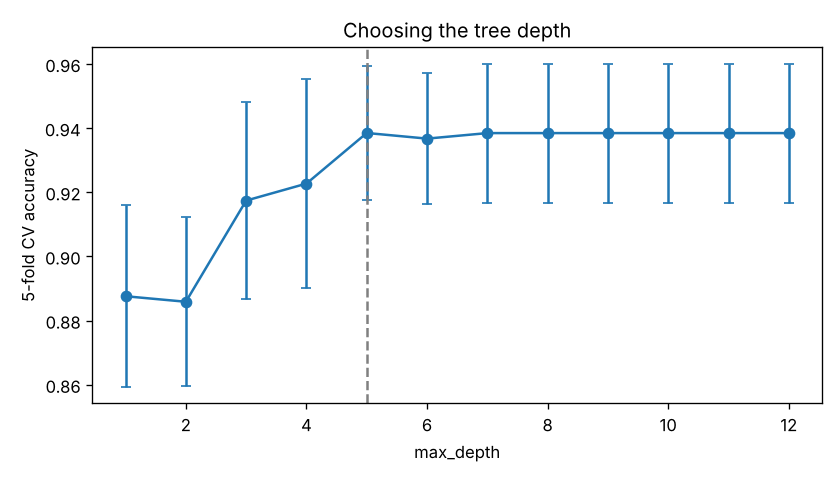
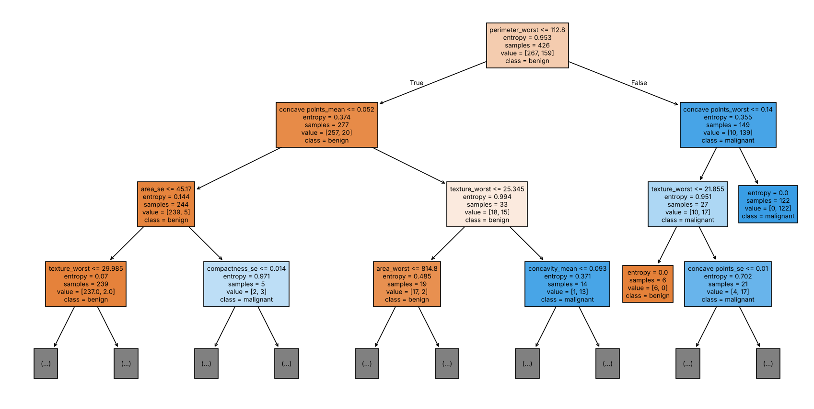
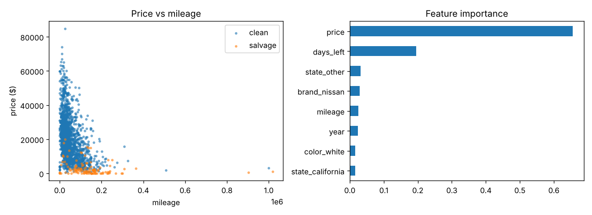

# Decision Trees in Python

Two end-to-end classification projects with scikit-learn decision trees: a medical diagnosis problem with balanced classes, and a used-car problem with a rare positive class.

## 1. Breast cancer diagnosis — [`breast_cancer_tree.py`](breast_cancer_tree.py)

Predicts whether a breast mass is **malignant** or **benign** from 30 features measured on a digitized biopsy image (Breast Cancer Wisconsin Diagnostic dataset, 569 samples).

- Tree depth chosen with 5-fold stratified cross-validation
- Evaluation on a held-out 25% split: accuracy, precision/recall, confusion matrix
- Tree visualization and feature importance

| Metric (test set) | Value |
| --- | --- |
| Accuracy | 0.937 |
| Malignant precision / recall | 0.96 / 0.87 |
| Best `max_depth` (CV) | 5 |
| Most important feature | `perimeter_worst` |





## 2. Salvage-title cars — [`car_title_tree.py`](car_title_tree.py)

Uses the US Cars auction dataset (~2,500 listings) to flag vehicles with a **salvage insurance** title instead of a clean one. Only 5% of listings are salvage, so the model uses balanced class weights and is judged by balanced accuracy rather than raw accuracy.

| Metric (test set) | Value |
| --- | --- |
| Balanced accuracy | 0.844 |
| Salvage recall | 0.77 |
| Salvage precision | 0.33 |

Price is by far the strongest signal: salvage cars sell much cheaper for their mileage and year.



## Run

```bash
pip install -r requirements.txt
python breast_cancer_tree.py
python car_title_tree.py
pytest            # data-loading and model sanity tests
```

Figures are written to `output/`. Results use a fixed random seed, so they are reproducible.

## Repository layout

```
breast_cancer_tree.py            # project 1
car_title_tree.py                # project 2
data_breast_cancer_wisconsin.csv
data_usa_cars.csv
docs/                            # figures and the original project write-up (PDF)
```

## Data sources

- Breast Cancer Wisconsin (Diagnostic) — UCI Machine Learning Repository
- US Cars Dataset — Kaggle

## Background

The original project write-up (PDF) is in [`docs/`](docs/). The code has since been rewritten into reproducible scripts with a proper train/test evaluation.

## License

[MIT](LICENSE)
